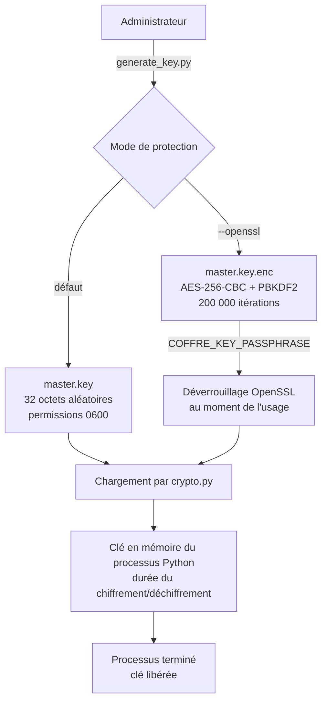
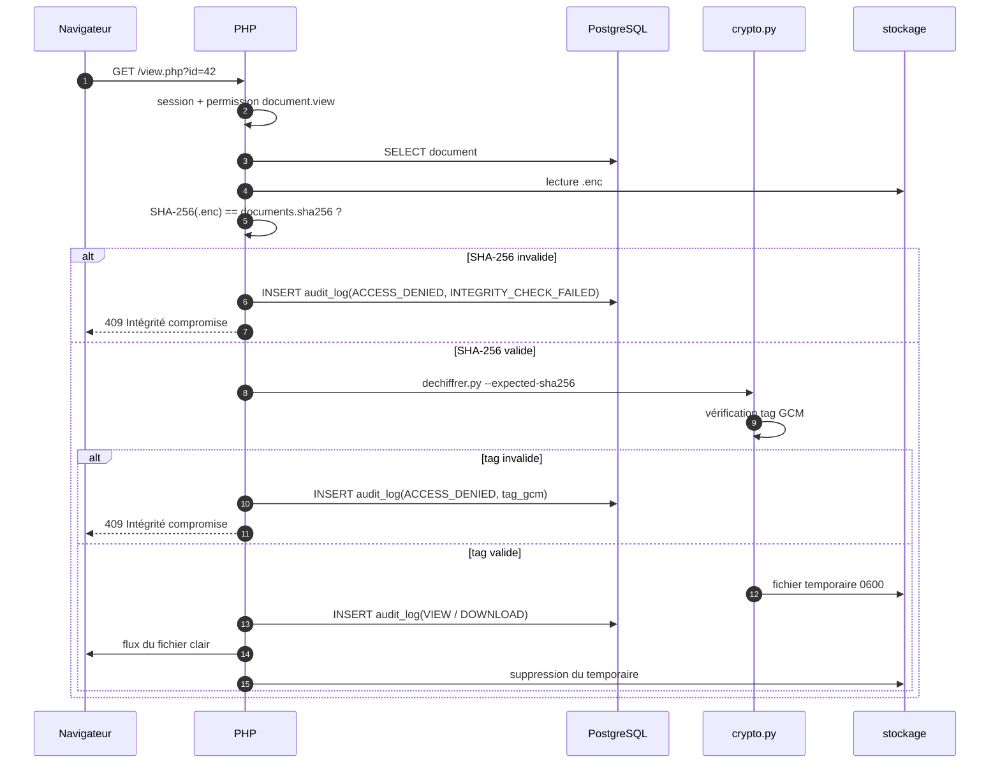

# Architecture cryptographique

Ce document décrit le cycle de vie de la clé maître et des documents, le format
du fichier chiffré, les contrôles d'intégrité et les hypothèses de sécurité du
prototype.

---

## 1. Principes

| Objectif | Moyen | Fichier(s) |
|---|---|---|
| Confidentialité du contenu | AES-256-GCM (clé 256 bits, nonce 96 bits) | `crypto/crypto.py` |
| Intégrité cryptographique | Tag GCM 128 bits vérifié au déchiffrement | `crypto/crypto.py` |
| Détection de corruption/remplacement | SHA-256 du fichier `.enc` comparé à la base | `src/documents.php` |
| Protection de la clé | Keystore hors code, permissions 0600 ou OpenSSL + variable d'environnement | `crypto/generate_key.py` |
| Séparation contenu/métadonnées | Contenu uniquement sur disque chiffré ; base = métadonnées | `public/upload.php` |
| Traçabilité | Audit append-only | `src/audit.php`, `schema_hardening.sql` |

Aucune primitive cryptographique n'est implémentée à la main : le chiffrement
utilise l'API `cryptography.hazmat.primitives.ciphers.aead.AESGCM`, et la
protection du keystore utilise OpenSSL.

**Ce qui n'est pas fait :** pas de crypto maison, pas de ECB, pas de nonce
constant, pas de clé dans le code source, pas de mot de passe stocké en clair.

---

## 2. Format d'un fichier `.enc`

```text
 offset 0        4   5        17                          fin
   │            │   │         │                            │
   ▼            ▼   ▼         ▼                            ▼
 +--------+-------+----------+----------------------------+
 | "CFV1" | 0x01  | nonce    | ciphertext + tag GCM (16)  |
 | 4 o    | 1 o   | 12 o     | n + 16 octets              |
 +--------+-------+----------+----------------------------+
```

- **Magic `CFV1`** : signature du format, permet de rejeter immédiatement un
  fichier étranger.
- **Version `0x01`** : permet une évolution future du format (nouvelle clé,
  en-tête enrichi, etc.).
- **Nonce 12 octets** : généré par `secrets.token_bytes(12)` pour **chaque**
  opération de chiffrement. Il est stocké en clair dans le fichier et en base
  (`documents.nonce`, `BYTEA`).
- **Ciphertext + tag** : `AESGCM.encrypt(nonce, plaintext, AAD)` retourne la
  concaténation `ciphertext || tag`. Les 16 derniers octets sont le tag GCM ;
  ils sont aussi stockés séparément en base (`documents.tag_auth`).
- **AAD** : `coffre-fort-documentaire|document|v1`, fixe. Les données
  authentifiées ne sont pas chiffrées mais toute modification invalide le tag.

Taille d'un fichier : `17 + taille_claire + 16` octets.

### Métadonnées en base

| Colonne | Contenu |
|---|---|
| `documents.chemin_chiffre` | `encrypted/<32 hex>.enc` (nom aléatoire, jamais le nom d'origine) |
| `documents.taille` | taille du fichier **en clair** d'origine |
| `documents.sha256` | SHA-256 du fichier `.enc` complet (hex 64) |
| `documents.nonce` | nonce 12 octets (`BYTEA`) |
| `documents.tag_auth` | tag GCM 16 octets (`BYTEA`) |
| `documents.mime_type` | type MIME réel détecté à l'upload |
| `documents.uploade_par` | clé étrangère utilisateur |

Le nom d'origine est conservé uniquement comme métadonnée d'affichage ; il
n'est jamais utilisé comme chemin de stockage (protection contre le path
traversal et les collisions).

---

## 3. Cycle de vie de la clé maître



### Génération

```powershell
# Mode 1 : fichier brut 0600 (simple, adapté au poste de démo)
python crypto/generate_key.py

# Mode 2 : keystore chiffré par OpenSSL (recommandé si disponible)
$env:COFFRE_KEY_PASSPHRASE = "phrase-de-passe-de-12-caracteres-minimum"
python crypto/generate_key.py --openssl
```

Le script :

1. tire 32 octets avec `secrets.token_bytes(32)` (CSPRNG de l'OS) ;
2. écrit le fichier de façon atomique (fichier temporaire + `os.replace`) ;
3. applique `chmod 0600` (POSIX) et documente les ACL Windows ;
4. en mode OpenSSL, chiffre la clé avec :
   ```bash
   openssl enc -aes-256-cbc -pbkdf2 -iter 200000 -md sha256 -salt \
       -in master.key -out master.key.enc \
       -pass env:COFFRE_KEY_PASSPHRASE
   ```
5. vérifie immédiatement que la clé peut être relue ;
6. supprime le fichier brut temporaire ;
7. n'affiche **jamais** la clé, seulement le chemin et l'empreinte du keystore.

### Chargement (ordre de priorité)

1. `COFFRE_MASTER_KEY` : 64 caractères hexadécimaux (variable d'environnement).
2. `COFFRE_MASTER_KEY_FILE` : chemin du keystore.
3. `crypto/keystore/master.key` : emplacement par défaut.

Si le fichier commence par `Salted__`, il est considéré comme un keystore
OpenSSL. La phrase de passe est lue dans `COFFRE_KEY_PASSPHRASE` et passée à
OpenSSL via `-pass env:...` : elle n'apparaît jamais dans la ligne de commande
ni dans les logs.

### Ce que la clé ne doit jamais faire

- être committée (`.gitignore` exclut `crypto/keystore/*`) ;
- être affichée dans une page web ou un journal ;
- être envoyée au navigateur ;
- être stockée dans PostgreSQL.

### Rotation de clé (procédure cible)

Le format actuel ne contient pas d'identifiant de clé (`key_id`). La rotation se
fait donc hors ligne :

1. sauvegarde de la base et des `.enc` ;
2. génération d'une nouvelle clé (`generate_key.py --key-file master.new.key`) ;
3. pour chaque document : `dechiffrer.py` avec l'ancienne clé →
   `chiffrer.py` avec la nouvelle → mise à jour de `nonce`, `tag_auth`, `sha256` ;
4. vérification d'un échantillon (déchiffrement + SHA-256) ;
5. bascule de l'application sur la nouvelle clé et redémarrage ;
6. conservation hors ligne de l'ancienne clé jusqu'à la fin de la rétention.

Évolution recommandée : en-tête `magic | version | key_id | nonce`, avec un
annuaire de clés et une période de recouvrement.

---

## 4. Cycle de vie d'un document

```mermaid
sequenceDiagram
    autonumber
    participant N as Navigateur
    participant P as PHP
    participant F as stockage
    participant X as crypto.py
    participant D as PostgreSQL

    N->>P: POST /upload.php (multipart + CSRF)
    P->>P: session + permission document.upload
    P->>P: extension + MIME finfo + taille <= 10 Mo
    P->>F: déplacement vers storage/uploads/<aléatoire>.upl
    P->>X: proc_open(chiffrer.py, [entrée, sortie])
    X->>X: nonce = 12 octets aléatoires
    X->>X: AES-256-GCM(nonce, clair, AAD)
    X->>F: écriture atomique <32 hex>.enc (0600)
    X-->>P: JSON {nonce, tag, sha256, chemin}
    P->>D: BEGIN ; INSERT documents ; INSERT audit_log(UPLOAD) ; COMMIT
    P->>F: suppression immédiate du .upl en clair (finally)
    P-->>N: 302 /dashboard.php
```

### Consultation / téléchargement



---

## 5. Double contrôle d'intégrité

Deux barrières indépendantes sont appliquées :

1. **SHA-256 du fichier `.enc`**, stocké en base, vérifié par PHP **avant** tout
   déchiffrement. Il détecte une corruption accidentelle, une troncature ou le
   remplacement du fichier par un autre `.enc` valide produit avec la même clé.
2. **Tag GCM**, vérifié par la librairie `cryptography` pendant le déchiffrement. Il
   authentifie le ciphertext, le nonce et l'AAD avec la clé. Toute modification
   d'un octet (ciphertext, tag, nonce, en-tête) provoque
   `INTEGRITY_CHECK_FAILED` et **aucun fichier clair n'est écrit**.

Le SHA-256 seul ne suffit pas (il n'est pas secret et ne prouve pas l'origine) ;
le tag GCM seul ne permet pas de détecter un remplacement par un autre document
chiffré avec la même clé. Les deux ensemble couvrent ces cas.

---

## 6. Gestion du nonce

- 12 octets = 96 bits, taille recommandée par NIST SP 800-38D pour GCM.
- Génération par `secrets.token_bytes`, donc CSPRNG de l'OS.
- Aucun compteur, aucune valeur déterministe, aucune réutilisation.
- Stocké avec le document (fichier + base) pour permettre le déchiffrement.
- Test automatisé : 1000 chiffrements du même fichier produisent 1000 nonces
  distincts (`tests/test_crypto.py::test_nonce_uniqueness`).

**Limite théorique :** avec des nonces aléatoires de 96 bits, la probabilité de
collision devient non négligeable autour de 2^32 chiffrements avec la même clé.
Pour ce prototype (< quelques milliers de documents), la marge est énorme. Une
production à grande échelle devrait utiliser un compteur par clé ou changer de
clé avant cette limite.

---

## 7. Menaces couvertes

| Menace | Contre-mesure | Vérification |
|---|---|---|
| Lecture du disque / vol de `.enc` | AES-256-GCM sans clé | Scénario G : copie hors système illisible |
| Modification d'un octet | Tag GCM + SHA-256 | Test automatisé + scénario G |
| Remplacement par un autre `.enc` | SHA-256 en base | `sha256_du_fichier_chiffre` |
| Accès URL directe sans session | `require_login` + log | Scénario G |
| Élévation de privilèges via URL | `require_permission` à chaque page | Scénario G (agent -> view) |
| Injection SQL | PDO préparé partout | Revue de code |
| XSS | `e()` sur toutes les sorties + CSP | Revue de code |
| Fixation de session | `session_regenerate_id(true)` après login | Code + test |
| CSRF | Jeton de session vérifié sur chaque POST | Code |
| Injection de commande | `proc_open` avec tableau d'arguments | `src/crypto_bridge.php` |
| Altération du journal | Triggers append-only | Test SQL |
| Fuite du contenu en clair | Suppression immédiate + temporaires 0600 | Code + inspection disque |

## 8. Menaces hors périmètre / limites

- Compromission de l'hôte pendant le déchiffrement (la clé et le clair sont en
  mémoire du processus) : un HSM/KMS et un serveur dédié réduiraient ce risque.
- Administrateur PostgreSQL malveillant : il peut lire les métadonnées, pas le
  contenu ; il pourrait toutefois désactiver les triggers (séparation des
  privilèges recommandée).
- Perte de la clé maître : les documents deviennent **définitivement**
  illisibles. Une sauvegarde chiffrée hors ligne est indispensable.
- Pas de MFA, pas de politique de complexité/réutilisation, pas de verrouillage
  de compte : à ajouter en production.
- Le nom original et les métadonnées restent en clair en base (choix assumé du
  sujet : contenu chiffré, métadonnées en base).

---

## 9. Codes d'erreur du module crypto

| Code | Signification | Code de sortie CLI |
|---|---|---|
| `INTEGRITY_CHECK_FAILED` | Tag GCM ou SHA-256 invalide, en-tête altéré | 3 |
| `MASTER_KEY_NOT_FOUND` | Keystore absent | 4 |
| `MASTER_KEY_PASSPHRASE_REQUIRED` | Keystore OpenSSL sans phrase de passe | 4 |
| `MASTER_KEY_UNWRAP_FAILED` | Phrase de passe incorrecte / OpenSSL | 4 |
| `INVALID_FORMAT` | Fichier `.enc` mal formé | 3 |
| `IO_ERROR` | Lecture/écriture impossible | 5 |
| `CRYPTO_TIMEOUT` | Subprocess trop long | 1 (PHP) |

PHP traduit ces codes en réponses HTTP 409 (intégrité) ou 500 (erreur interne)
et journalise les échecs d'intégrité comme `ACCESS_DENIED` avec le motif
`INTEGRITY_CHECK_FAILED`.
